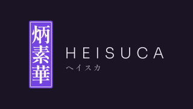
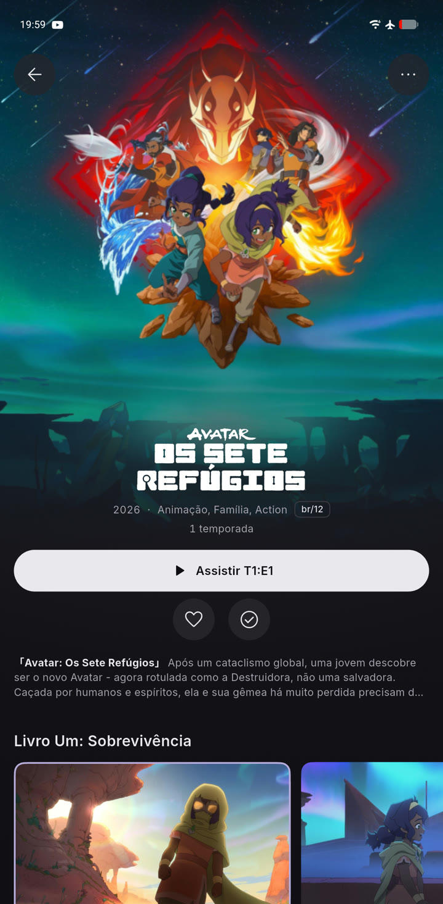
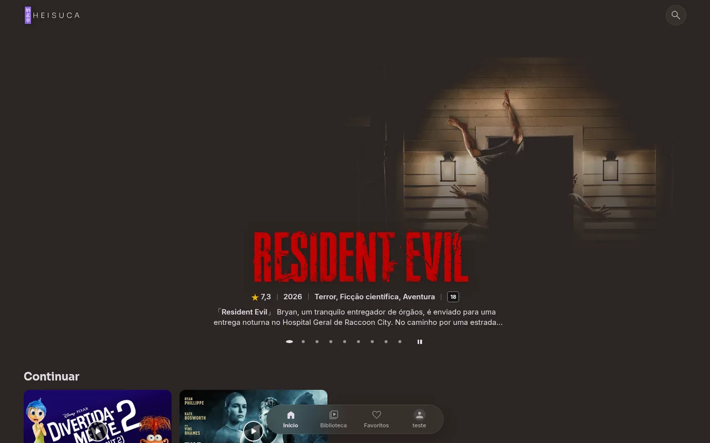
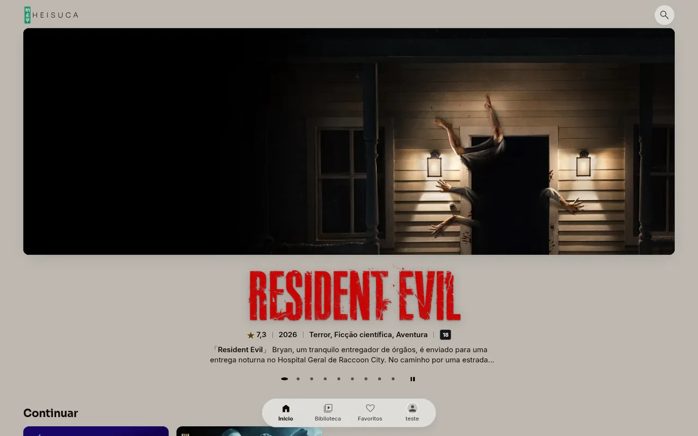
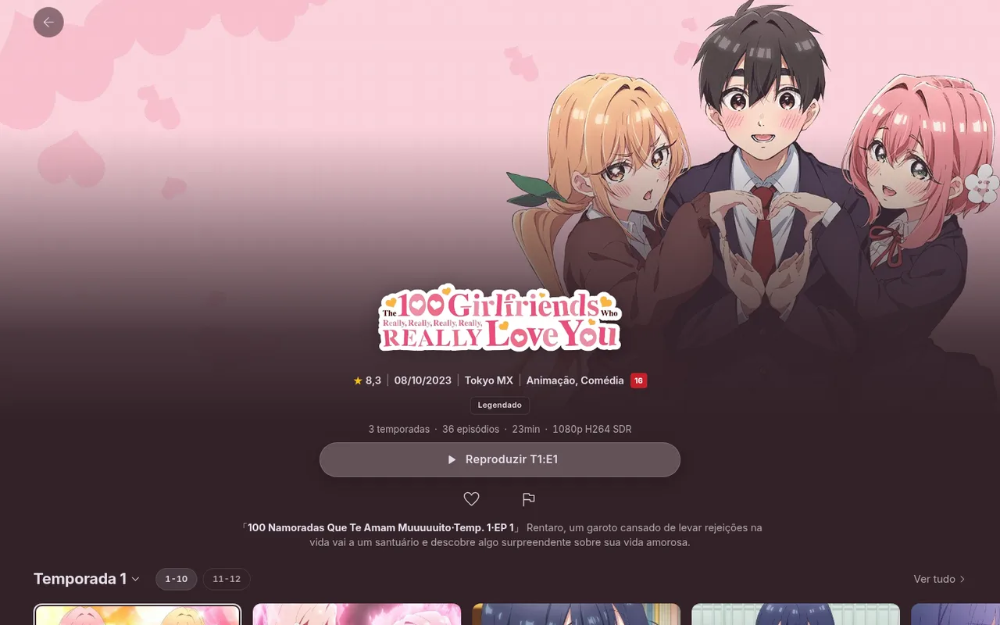

<p align="center">
  
</p>

<p align="center"><strong>Nada entre você e o filme.</strong></p>

<p align="center">
  <a href="LICENSE"></a>
  
  
  
</p>

<p align="center">
  <a href="#baixar"><strong>Baixar</strong></a> ·
  <a href="#o-que-tem">O que tem</a> ·
  <a href="#pedir-ou-relatar">Pedir ou relatar</a> ·
  <a href="#para-desenvolver">Desenvolver</a>
</p>

---

O **Heisuca** (炳素華, *hei-su-ka*) é uma suíte de players para quem tem a própria biblioteca de filmes, séries e
animes em um servidor **Jellyfin** ou **Plex**. Uma marca só, o mesmo jeito de usar no site, no celular e na TV:
direção japonesa minimalista, capa em primeiro lugar e nenhum menu no caminho entre a pessoa e o play.

<p align="center">
  
  &nbsp;
  
</p>

## Baixar

O app é gratuito e de código aberto. Você precisa ter acesso a um servidor Jellyfin ou Plex (o seu ou o de alguém
que compartilhou com você); o Heisuca não traz filmes nem séries.

| Onde | Baixar | Para quem |
|---|---|---|
| **Celular Android** | [**heisuca-arm64-v8a.apk**](https://heisuca.docaio.com.br/pacotes/heisuca-arm64-v8a.apk) | Celulares e tablets Android de 64 bits (quase todos desde 2017) |
| **Android TV e TV box** | [**heisuca-tv.apk**](https://heisuca.docaio.com.br/pacotes/heisuca-tv.apk) | Android TV, Google TV, Fire TV e TV box, inclusive os de 32 bits |
| **Navegador** | [heisuca.docaio.com.br](https://heisuca.docaio.com.br) | Computador, celular e TVs com navegador atual |

Os links acima são sempre os da **versão mais nova** (hoje: 2.0.36).

**Como instalar no Android**

1. Toque no link pelo próprio aparelho e abra o arquivo baixado.
2. O Android pergunta se o navegador pode instalar apps: permita e toque em **Instalar**.
3. Abra o Heisuca, digite o endereço do seu servidor, usuário e senha (ou entre com o Plex).

Depois disso o app **se atualiza por dentro**: quando sai versão nova, ele avisa em **Você › Atualizações**.
Quem recebeu um código de testes digita o código nessa mesma tela para receber as versões de teste.

## O que tem

- **Jellyfin e Plex no mesmo app.** Entra com usuário e senha (Jellyfin) ou com o código do plex.tv (Plex), e o resto
  da tela é igual para os dois.
- **Início em tela cheia.** O destaque ocupa a tela com o logo do título, e o fundo acompanha a cor de cada pôster.
- **Página do título inteira:** temporadas, episódios, elenco, "Mais como este" e os dados do arquivo.
- **Explorar** por biblioteca, gênero e ordem, com "Não vistos" e ✓ no que você já viu.
- **Toca o arquivo do jeito que ele é.** Reprodução direta quando o aparelho aguenta; quando não aguenta, o servidor
  converte. Áudio e legenda trocam durante o vídeo, e legendas ASS saem com o estilo original.
- **Baixados**, para assistir sem internet.
- **Três temas com nome e paleta próprios:** Shikkoku (escuro), Hisui (claro) e Sumi (preto, para tela OLED).
- **Pedidos pelo Seerr**, quando o servidor tem: buscar o que falta e acompanhar em "Meus pedidos".
- **Feito para o Brasil:** tudo em PT-BR, inclusive a busca de legendas em português (Jellyfin).
- **Sem telemetria.** O app só conversa com o seu servidor.

<p align="center">
  
  
</p>

## Onde roda

| Tela | Situação | Código |
|---|---|---|
| Celular Android | em uso | [`apps/app`](apps/app) — Flutter |
| Android TV e TV box | em uso | [`apps/app`](apps/app) — o mesmo código, com a interface de controle remoto |
| Site (navegador) | em uso | repositório à parte |
| TVs Samsung e LG | teste fechado | — |
| iPhone | planejado | — |

## Pedir ou relatar

Achou um problema ou tem uma ideia? Abra uma issue; pode escrever em português, do seu jeito.

- 💡 [**Fazer um pedido ou dar uma ideia**](https://github.com/CaioGuerras/heisuca/issues/new?template=pedido.yml)
- 🐞 [**Relatar um problema**](https://github.com/CaioGuerras/heisuca/issues/new?template=problema.yml)
- 📋 [Ver o que já foi pedido](https://github.com/CaioGuerras/heisuca/issues)

Para um problema, o que mais ajuda é a **versão** (Você › Sobre), o **aparelho** e o **passo a passo**. Não cole senha,
endereço do seu servidor nem código de testes.

## Para desenvolver

```bash
cd apps/app
flutter pub get
flutter run
```

O app está no meio de uma reescrita de telas (a "V2"), que vive em `apps/app/lib/design` e `apps/app/lib/features`.
Mais detalhes em [`apps/app/README.md`](apps/app/README.md). Regras para contribuir, inclusive para agentes de IA:
[`AGENTS.md`](AGENTS.md).

## Créditos

- **[Plezy](https://github.com/edde746/plezy)** (GPL-3.0), de edde746 e colaboradores: a base do app Android.
- **[Findroid](https://github.com/jarnedemeulemeester/findroid)** e **[Moonfin](https://github.com/Moonfin-Client)**:
  referência de ideias para o cliente Jellyfin.
- Bibliotecas e fontes: as licenças de cada uma estão na tela Sobre do app.
- 🤝 **Rosiel Victor** ([all.dev.br](https://all.dev.br)), pelo apoio, pela generosidade e pela parceria técnica.
- **Locadora** ([locadora.cc](https://locadora.cc)), pela preservação incansável da cultura e do cinema.

## Licença

[GPL-3.0](LICENSE). O Heisuca é software livre: qualquer pessoa pode ver, estudar e melhorar o código.

<p align="center"><sub>Feito com amor, para Isis e Heitor</sub></p>
<p align="center"><sub>🤖 Em parceria com IA: Claude, Codex e Gemini.</sub></p>
