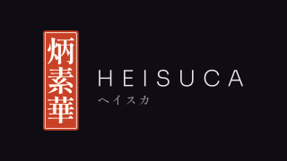
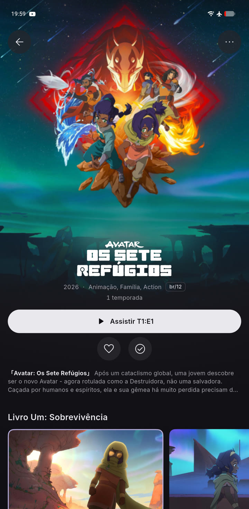
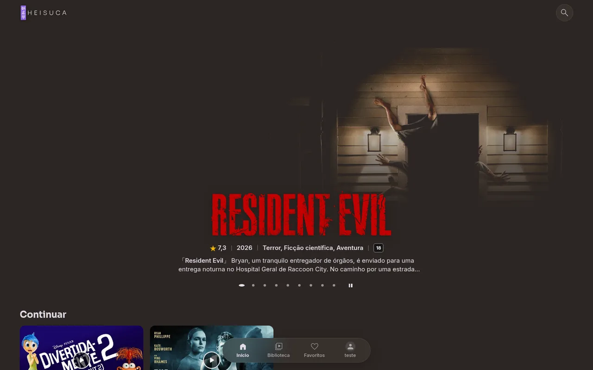
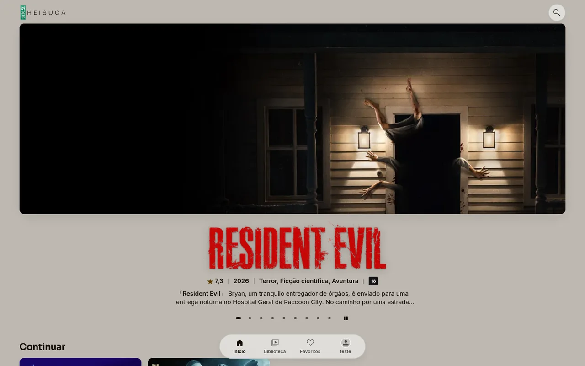
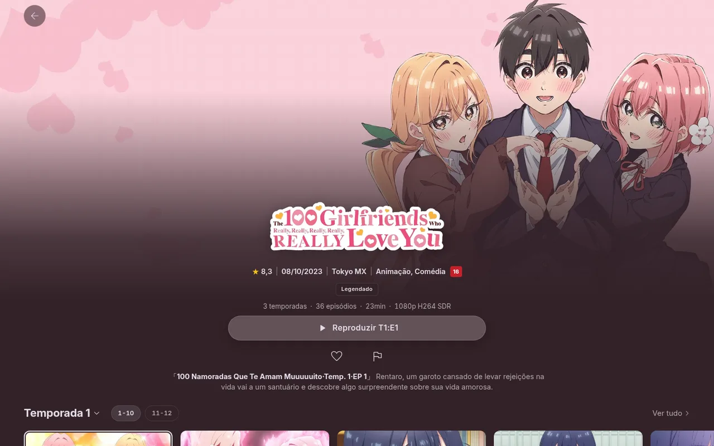

<p align="center">
  
</p>

<p align="center"><strong>Nada entre você e o filme.</strong></p>

<p align="center">
  <a href="https://github.com/CaioGuerras/heisuca/releases/latest"></a>
  <a href="LICENSE"></a>
  
  
</p>

<p align="center">
  <a href="#baixar"><strong>Baixar</strong></a> ·
  <a href="#o-que-tem">O que tem</a> ·
  <a href="#pedir-ou-relatar">Pedir ou relatar</a> ·
  <a href="#para-desenvolver">Desenvolver</a>
</p>

---

O **Heisuca** (炳素華, *hei-su-ka*) é um player para quem tem a própria biblioteca de filmes, séries e animes em um
servidor **Jellyfin** ou **Plex**. O mesmo jeito de usar no celular, na TV e no navegador: visual japonês
minimalista, capa em primeiro lugar e nenhum menu entre você e o play.

<p align="center">
  
  &nbsp;
  
</p>

## Baixar

<p align="center">
  <a href="https://github.com/CaioGuerras/heisuca/releases/latest"></a>
  <a href="https://github.com/CaioGuerras/heisuca/releases/latest"></a>
  <a href="https://heisuca.docaio.com.br/#/apps"></a>
  <a href="https://heisuca.docaio.com.br"></a>
</p>

**Qual app para qual aparelho**

| App | Aparelho e download |
|---|---|
| Windows | Computador de 64 bits. Versão 2.1.1 estável; baixe pelo [site](https://heisuca.docaio.com.br/#/apps) ou pelos [Releases](https://github.com/CaioGuerras/heisuca/releases/tag/windows-v2.1.1). |
| Android | Celular e tablet. APK arm64 nos Releases. |
| Android TV / Google TV / Fire TV | APK nos Releases. Use o universal para TV box antiga e aparelhos de 32 bits. |

Os APKs ficam nos [**Releases**](https://github.com/CaioGuerras/heisuca/releases/latest). Em cada versão há dois
arquivos:

| Arquivo | Para quem |
|---|---|
| `heisuca-<versão>-arm64.apk` | Celulares, tablets e TVs recentes (64 bits; quase todos desde 2017) |
| `heisuca-<versão>-universal.apk` | TV box e aparelhos mais antigos, inclusive os de 32 bits |

O app é gratuito e de código aberto. Ele não traz filmes nem séries: você precisa de acesso a um servidor Jellyfin ou
Plex, seu ou de alguém que compartilhou com você.

**Como instalar no Android**

1. Abra a página de Releases pelo próprio aparelho e toque no arquivo.
2. Se o Android perguntar, permita que o navegador instale apps e toque em **Instalar**.
3. Abra o Heisuca e entre no seu servidor (Jellyfin) ou com a sua conta (Plex).

**Como instalar no Windows**

1. Baixe o instalador pelo [site](https://heisuca.docaio.com.br/#/apps).
2. Se o SmartScreen avisar, clique em **Mais informações › Executar assim mesmo**.
3. Abra o Heisuca e entre no seu servidor.

**Atualizações.** O app avisa sozinho quando sai versão nova, em **Você › Atualizações**. Ali você escolhe o canal:

- **Estável:** a versão recomendada para o dia a dia.
- **Beta:** recebe as novidades antes, com mais chance de algum problema. As versões Beta também ficam nos Releases,
  marcadas como *pré-lançamento*.

## O que tem

- **Jellyfin e Plex no mesmo app.** Usuário e senha (Jellyfin) ou o código do plex.tv (Plex). O
  resto da tela é igual para os dois.
- **Início em tela cheia.** O destaque ocupa a tela com o logo do título, e o fundo acompanha a cor de cada pôster.
- **Página do título inteira:** temporadas, episódios, elenco, "Mais como este" e os dados do arquivo.
- **Busca e Explorar** por biblioteca, gênero e ordem, com ✓ no que você já viu.
- **Minha lista:** o coração de favorito no Jellyfin e a Minha lista da sua conta no Plex.
- **Toca o arquivo do jeito que ele é.** Reprodução direta quando o aparelho aguenta; quando não aguenta, o servidor
  converte. Áudio e legenda trocam durante o vídeo, e legendas ASS saem com o estilo original.
- **Baixados**, para assistir sem internet.
- **Três temas:** Shikkoku (escuro), Hisui (claro) e Sumi (preto, para tela OLED).
- **Pedidos pelo Seerr**, quando o servidor tem: buscar o que falta e acompanhar em "Meus pedidos".
- **Feito para o Brasil:** tudo em PT-BR, inclusive a busca de legendas em português (Jellyfin).
- **Sem telemetria.** O app só conversa com o seu servidor.

<p align="center">
  
  
</p>

## Onde roda

| Tela | Situação |
|---|---|
| Celular Android | em uso — [`apps/app`](apps/app) (Flutter) |
| Android TV e TV box | em uso — o mesmo código, com interface de controle remoto |
| Navegador | em uso — [heisuca.docaio.com.br](https://heisuca.docaio.com.br) |
| TVs Samsung e LG | em teste |
| iPhone | planejado |

## Pedir ou relatar

Achou um problema ou tem uma ideia? Abra uma issue; pode escrever em português, do seu jeito.

- 💡 [**Fazer um pedido ou dar uma ideia**](https://github.com/CaioGuerras/heisuca/issues/new?template=pedido.yml)
- 🐞 [**Relatar um problema**](https://github.com/CaioGuerras/heisuca/issues/new?template=problema.yml)
- 📋 [Ver o que já foi pedido](https://github.com/CaioGuerras/heisuca/issues)

Para um problema, o que mais ajuda é a **versão** (Você › Sobre), o **aparelho** e o **passo a passo**. Não cole senha
nem o endereço do seu servidor.

## Para desenvolver

```bash
cd apps/app
flutter pub get
flutter run
```

As telas novas vivem em `apps/app/lib/design` e `apps/app/lib/features`. Mais detalhes em
[`apps/app/README.md`](apps/app/README.md). Regras para contribuir, inclusive para agentes de IA: [`AGENTS.md`](AGENTS.md).

## Créditos

- **[Plezy](https://github.com/edde746/plezy)** (GPL-3.0), de edde746 e colaboradores: a base do app Android.
- **[Findroid](https://github.com/jarnedemeulemeester/findroid)** e **[Moonfin](https://github.com/Moonfin-Client)**:
  referência de ideias para o cliente Jellyfin.
- Bibliotecas e fontes: as licenças de cada uma estão na tela Sobre do app.
- 🤝 **Rosiel Victor** ([all.dev.br](https://all.dev.br)), pelo apoio, pela generosidade e pela parceria técnica.
- **Locadora** ([locadora.cc](https://locadora.cc)), pela preservação incansável da cultura e do cinema.

## Licença

[GPL-3.0](LICENSE). O Heisuca é software livre: qualquer pessoa pode ver, estudar e melhorar o código.

<p align="center"><sub>Feito com amor, para Isis e Heitor</sub></p>
<p align="center"><sub>🤖 Em parceria com IA: Claude, Codex e Gemini.</sub></p>
