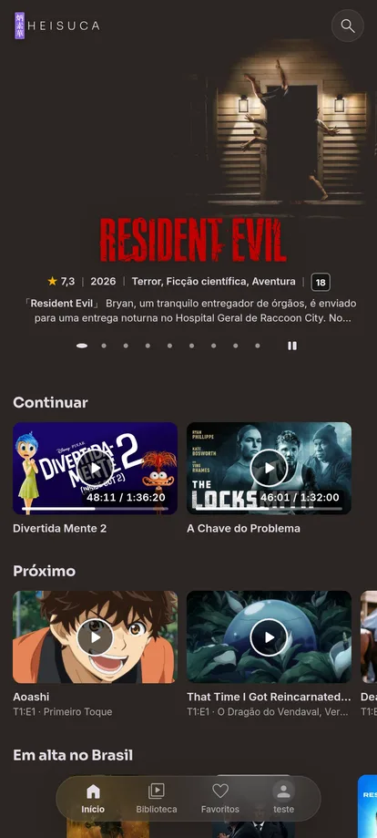

<p align="center">
  
</p>

<p align="center"><strong>Nada entre você e o filme.</strong></p>

<p align="center">
  <a href="LICENSE"></a>
  
  
  
</p>

---

O **Heisuca** (炳素華, *hei-su-ka*) é uma suíte de players para quem tem a própria biblioteca de filmes, séries e
animes em um servidor **Jellyfin** ou **Plex**. Uma marca só, o mesmo jeito de usar no site, no celular e na TV:
direção japonesa minimalista, capa em primeiro lugar e nenhum menu no caminho entre a pessoa e o play.

<p align="center">
  
  &nbsp;
  
</p>

## O que tem

- **Jellyfin e Plex no mesmo app.** Entra com usuário e senha (Jellyfin) ou com o código do plex.tv (Plex), e o resto
  da tela é igual para os dois.
- **Toca o arquivo do jeito que ele é.** Reprodução direta quando o aparelho aguenta; quando não aguenta, o servidor
  converte em HLS. Áudio e legenda trocam durante o vídeo, legendas ASS saem com o estilo original.
- **Continuar, Próximo e destaques** na tela inicial, com a cor de cada pôster puxada para a página do título.
- **Temas com nome e paleta próprios:** Shikkoku (roxo, escuro) e Hisui (verde, claro).
- **Pedidos pelo Seerr**, quando o servidor tem: buscar o que falta e acompanhar em "Meus pedidos".
- **Feito para o Brasil:** tudo em PT-BR, inclusive a busca de legendas em português (Jellyfin).

<p align="center">
  
  
</p>

## Onde roda

| Tela | Situação | Código |
|---|---|---|
| Site (navegador, celular e TVs com navegador) | em uso | [`apps/web`](apps/web) — Preact + Vite, alvo Chrome 88 |
| Android (celular) e Android TV | teste fechado | [`apps/app`](apps/app) — Flutter |
| iPhone | planejado | — |

## Para desenvolver

```bash
# site
cd apps/web
npm ci
npm run dev            # servidor local
node --test testes/*.test.ts
npm run build

# Android
cd apps/app
flutter pub get
flutter run
```

Mais detalhes em [`apps/web/SITE.md`](apps/web/SITE.md) e [`apps/app/README.md`](apps/app/README.md).
Regras para contribuir (inclusive para agentes de IA): [`AGENTS.md`](AGENTS.md).

## Créditos

- **[Plezy](https://github.com/edde746/plezy)** (GPL-3.0), de edde746 e colaboradores: a base do app Android.
- **[Findroid](https://github.com/jarnedemeulemeester/findroid)** e **[Moonfin](https://github.com/Moonfin-Client)**:
  referência de ideias para o cliente Jellyfin.
- Bibliotecas do site: Preact, hls.js, JASSUB, blurhash, Material Symbols, Inter e Sora (licenças na tela Sobre).
- **Rosiel Victor** ([all.dev.br](https://all.dev.br)), pelo apoio, pela generosidade e pela parceria técnica.
- **Locadora**, pela preservação incansável da cultura e do cinema.

Feito em parceria com IA: Claude, Codex e Gemini.

## Licença

[GPL-3.0](LICENSE). O Heisuca é software livre: qualquer pessoa pode ver, estudar e melhorar o código.

<p align="center"><sub>Para a família, que sempre se reuniu diante da tela.</sub></p>
