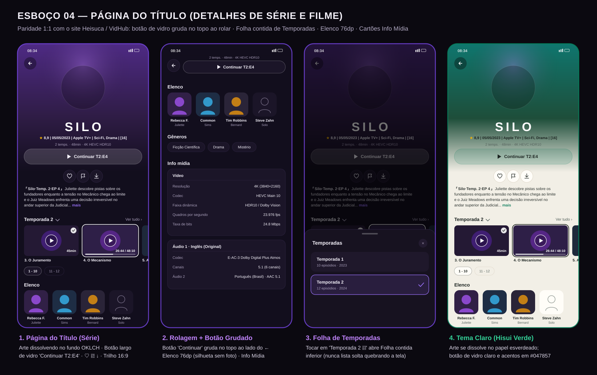
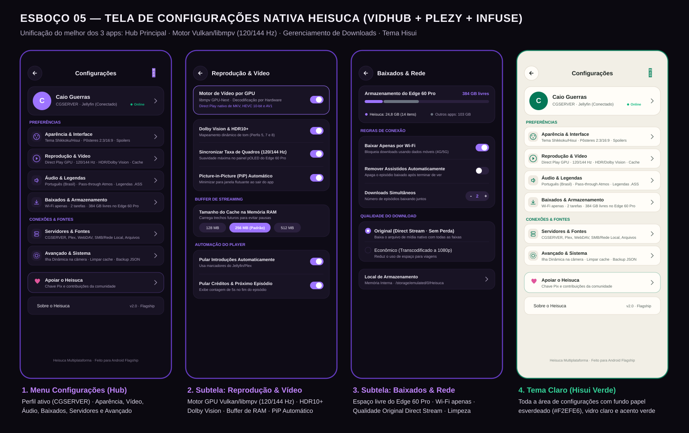

# Próxima etapa — ficha do título, fontes, configurações e player

Data: 23/10/2026 (São Paulo). Estado: análise do código e proposta de implementação;
este documento NÃO anuncia alterações funcionais nem um novo APK.
Base auditada: `82dd317dd1a9cff533e1a3e1e9818516b0580c75`, branch `codex/heisuca-home-site`.
APK anterior: código `6a526bd`, versão 2.0.2+3, execução 39892410268.

## Retorno atual de Caio

Caio informou que a Home ficou correta nos testes preliminares. Preservar essa Home.
A prioridade seguinte é a página de exibição/detalhes do conteúdo, tomando VidHub
como inspiração principal e recuperando os esboços aprovados com o Gemini. Ele também
relatou menos opções avançadas que no desenho, player com aparência antiga e falta de
troca de serviço independente. Considera que juntar bibliotecas pode confundir.

Os prints novos `16589.png` e `16590.png`, vistos nesta sessão, mostram a mesma ficha
do VidHub no topo e rolada: arte vertical ocupando a largura, logo central do título,
metadados, botão largo de reprodução, favorito/visto, sinopse contextual do episódio,
notas identificadas, temporadas, trilho 16:9 de episódios, grupos de dez, elenco,
gêneros e cartões de informações de vídeo/áudio. A segunda captura mostra a ação de
reprodução no topo rolado. Os anexos originais desta conversa não foram adicionados
ao git; os nomes e esta descrição registram sua referência.

## Referências recuperadas e correção do índice antigo

O histórico disponível é o dossiê em
[`dossie_2026-10-21/DOSSIE_HEISUCA_MOBILE_2026-10-21.md`](dossie_2026-10-21/DOSSIE_HEISUCA_MOBILE_2026-10-21.md)
e `DOCUMENTACAO_ESBOCOS_E_REFATORACAO_2026-10-22.md` na raiz. São registros produzidos
pelo outro agente, não uma exportação integral verificada da conversa do Telegram.
Não há acesso automático às mensagens do GeminiBot nem ao daemon ai-memory aqui.

O diretório de imagens tem 75 arquivos, 54 blobs distintos. Foram inspecionadas duas
capturas novas e 40 referências distintas do acervo, incluindo folhas de contato e
leitura ampliada dos esboços centrais. Não alegar que foi recuperado/verificado o lote
exato de 42 prints mencionado por Caio. Seis referências grandes vieram sem conteúdo
pelo endpoint de arquivos (>1 MB), e a tentativa via blobs foi rejeitada pelo leitor
UTF-8: `07_player_20_9_gestos_controles.png`, `step_632_step_635_media_0.png`,
`step_642_step_645_media_0.png`, `step_646_step_649_media_0.png`,
`step_648_step_651_media_0.png`, `step_772_step_775_media_0.png`.

**Usar o conteúdo da imagem, não confiar no nome antigo:**

| Referência visual correta | Arquivo no acervo | Observação |
|---|---|---|
| Ficha do título aprovada, Esboço 04 | `step_511_step_511_media_0.png` | Quatro estados: topo, rolagem, folha de temporadas e Hisui. |
| Configurações aprovadas, Esboço 05 | `step_695_step_698_media_0.png` | Hub, reprodução, downloads/rede e tema claro. |
| Player/HUD e áudio/legendas | `07b_player_corrigido_pular_abertura.png` | Também há versões em `step_789...` e `step_795...`. |
| Player, episódios e ajustes | `step_791_step_794_media_0.png` | Também em `step_797_step_800_media_0.png`. |
| Adicionar fontes | `storyboard_16_adicionar_fontes_plex.jpg` | Adição/autenticação, não substitui o seletor de fonte ativa. |

O arquivo chamado `04_ficha_titulo_bottom_sheet.png` mostra, na realidade, o menu de
toque longo. O `06_configuracoes_aparelho_edge60pro.png` mostra Contato do VidHub.
`05_biblioteca_filtros_busca_unificada.png` mostra um estudo de ilha dinâmica.
Preservar os originais como histórico; não construir telas usando esses rótulos errados.

Imagens centrais para abrir:

## Diagnóstico da ficha atual

`apps/app/lib/heisuca/heisuca_title_sheet.dart` abre uma rota de tela cheia. Hoje tem
hero fixo de 360, título em texto, poucos badges, ações, sinopse e lista vertical de
episódios. Não implementa a composição completa aprovada: logo central, botão fixado
pela rolagem, seletor real de temporadas, trilho de episódios, elenco/gêneros e Info mídia.

Há problemas funcionais a resolver junto ao desenho:

- `_loadEpisodes()` consulta todos os descendentes da série de uma vez; sem seleção
  de temporada nem paginação. O botão escolhe `widget.episode` ou `_episodes.first`:
  não resolve o próximo episódio real antes de dizer "Continuar Temporada".
- A ficha usa o item vindo do card sem buscar seus detalhes completos. Ausência de
  streams/logo/elenco no card não significa ausência desses dados no servidor.
- Um erro ao carregar episódios vira lista vazia sem mensagem de tentar novamente.
- `_isDownloading` fica verdadeiro depois de enfileirar o download: o ícone de
  concluído não representa o estado real da tarefa e não acompanha seu ciclo.
- A Home chama essa ficha diretamente; outros fluxos passam por `cgflixOpenDetails`
  e `navigateToMediaItemDetails`, que usam a tela upstream. Unificar a entrada móvel
  para não ter duas fichas diferentes conforme o local onde a pessoa toca.

Infraestrutura que deve ser reutilizada:

- `MediaServerClient.fetchItemWithOnDeck`: item completo + próximo episódio real;
  `onItemReady` permite desenhar cedo sem esperar a consulta adicional de on-deck.
- `fetchChildren`: temporadas da série; `fetchSeasonEpisodesPage`: episódios paginados.
- `MediaItem`: `clearLogoPath`, `roles`, `genres`, `ratings`, `contentRating`, progresso,
  versões e identificação de origem. As notas têm fonte; não duplicar uma nota genérica
  como IMDb/TMDB/Rotten Tomatoes.
- `MediaServerClient.getFileInfo` e `MediaFileInfo`: codec, perfil, resolução, FPS,
  bitrate, áudio, legendas e arquivos. Já há parser neutro Plex/Jellyfin: não remontar
  tudo apenas a partir de strings de display nem criar outro modelo bruto exclusivo.
- `cgflixPlay`, `navigateToVideoPlayer`, `DownloadProvider`, estado de visto/favorito
  e seleção real de versão/faixas. Sem novos estados locais que mintam sobre o servidor.

## Proposta da ficha a implementar

Esta é uma consolidação das aprovações anteriores e dos prints atuais. Não é necessário
redesenhar a Home nem adotar outra identidade visual.

1. **Topo imersivo.** Arte responsiva até as bordas e transição contínua para o fundo
   derivado da obra, usando o cálculo já validado da Home. Voltar no canto esquerdo,
   menu de ações no direito, logo real central; título legível se não houver clear-logo.
   Tratar arte vertical/horizontal sem deformar nem fazer corte fixo de 360 px.
2. **Identificação.** Nota com fonte, data/ano, estúdio quando informado, gêneros e
   classificação; abaixo temporadas/duração e resumo técnico da versão/episódio alvo.
   Quebrar linhas em telas estreitas. Não mostrar 4K/HDR de um episódio diferente.
3. **Ação principal única.** Botão largo translúcido "Assistir" ou "Continuar T1:E7"
   conforme estado real. Ao sair da posição original, o mesmo comando fica compacto
   ao lado de voltar no topo. Sem duas ações sobrepostas nem retângulo de vidro fixo.
   Em séries, ausência/erro de on-deck deve permitir escolher episódio, sem iniciar
   silenciosamente E1 sob rótulo de continuar. Extras e reproduzir do início no menu.
4. **Ações rápidas.** Favoritar, visto/não visto e download com rótulos acessíveis.
   Enfileirado, baixando, falhou e concluído vêm do provedor. Série pede seleção real
   de temporada/episódios para baixar. Sem pedido Seerr como ação de título já disponível.
5. **Sinopse contextual.** Série com sinopse geral; o episódio alvo pode ter uma linha
   própria identificada. Expandir "mais". Respeitar ocultação de spoilers quando ativa.
6. **Temporadas e episódios.** Folha inferior contida para temporadas; trilho 16:9 com
   nome/número, duração, visto e progresso. Seleção inicial acompanha o episódio que
   abriu a ficha ou o on-deck. "Ver tudo" abre a lista completa da temporada; grupos
   1–10, 11–20 etc. derivados dos episódios existentes, não de duração/contagem inventada.
   Tratar Especiais (temporada 0), episódio ausente e temporadas extensas.
7. **Elenco e gêneros.** Retratos reais, nomes/papéis; silhueta ou iniciais quando não
   houver foto, sem rostos sintéticos. Gêneros usam filtros reais quando suportados.
8. **Info mídia.** Cartões de vídeo, áudios e legendas por versão; dados ausentes omitidos
   ou "Não informado", nunca "Unknown" como uma capacidade. Caminho completo em detalhes
   técnicos expansíveis/copiáveis, não ocupando a página principal. Carregar essa seção
   sob demanda. Fonte/servidor identificado quando necessário para distinguir duplicados.

Para filmes, omitir temporadas/episódios; preservar versões, extras/coleção/relacionados
quando retornados pelo servidor. Hisui usa jade, fundo claro e contraste adequado;
Shikkoku usa o tema escuro. Evitar pintar texto claro sobre qualquer imagem clara sem
tratamento. Honrar tamanho de texto do sistema e redução de movimento.

## Troca de serviço: causa e proposta

### O que existe

`HeisucaHomeScreen._onServersChanged()` escolhe
`visibleOnlineClients.values.whereType<JellyfinClient>().firstOrNull`. Se há Jellyfin
e Plex conectados, isso mantém o Jellyfin como fonte da Home, sem escolha da pessoa.
O ramo de hubs só entra quando não há esse cliente Jellyfin.

No perfil, "Trocar Usuário / Servidor" abre `ProfileSwitchScreen`. A tela troca
**perfis** e oferece gerenciar suas conexões; ela não seleciona uma fonte de navegação.
`DataAggregationService` pode consultar vários servidores e combinar resultados, de
modo que a biblioteca/busca podem ter outro escopo que a Home. Agrupar por servidor
(`groupLibrariesByServer`) organiza a apresentação; não equivale a selecionar um servidor.

Já existe caminho de adição por gerenciar perfil → conexões → adicionar (Plex,
Jellyfin/Emby), mas é pouco evidente no desenho Heisuca. Não chamar isso de troca rápida.

### Comportamento recomendado

- Separar "Quem está usando?" (perfil) de "Qual fonte estou vendo?" (servidor).
- No menu do usuário, mostrar **Fonte atual: Jellyfin · nome do servidor**, abrindo
  uma folha com os servidores autorizados, backend, nome e estado de conexão, além
  de Adicionar/Gerenciar fontes. Preservar o topo da Home aprovado, sem nova barra fixa.
- Padrão: uma fonte por vez. Home, bibliotecas, busca e favoritos usam a mesma seleção.
  "Todas as fontes" pode ser opção explícita posterior; não ativar agregação silenciosa.
- Conta Plex e servidor Plex são entidades diferentes: uma conta pode autorizar vários
  servidores. Selecionar o servidor concreto, não apenas a palavra Plex.
- Manter as outras contas autenticadas. Trocar fonte não é sair, remover conexão ou
  trocar de perfil. SMB/WebDAV continuam identificados como pendentes onde aplicável.
- Se a fonte escolhida estiver offline, mostrá-la offline e oferecer tentar novamente
  ou escolher outra. Não trocar automaticamente para o primeiro Jellyfin acessível.

Arquitetura: adicionar estado de seleção de navegação separado da autorização/visibilidade
do perfil. `MultiServerProvider.setVisibleServerIds` e o binder já controlam acesso;
não usar esse filtro como um seletor improvisado, pois reconexão/rebind pode repovoá-lo.
O escopo efetivo deve ser interseção dos servidores autorizados e da seleção da pessoa.
Persistir por perfil; invalidar se sua conexão for removida. Chaves de cache/rotas/ações
continuam incluindo backend/servidor/usuário/item. Resultados assíncronos de A não podem
reaparecer após trocar para B. Cada item conserva a origem para play, favorito e download.

## Configurações: recuperar a amplitude do esboço

A tela Heisuca tem duas abas e expõe apenas um subconjunto. Muitas funções já estão
no motor e em telas de configuração existentes. A correção é ampliar o hub Heisuca e
reutilizar preferências e callbacks, mantendo condicionais de plataforma/motor.
Presença em código não equivale a teste no aparelho de Caio.

| Grupo proposto | Recursos existentes a trazer para a interface Heisuca | Evidência principal |
|---|---|---|
| Reprodução | mpv/ExoPlayer, PiP automático, gestos brilho/volume/zoom, saltos, retomada, próximo episódio/contagem, abertura/créditos | `screens/settings/playback_settings_screen.dart`, `SettingsService`, `VideoPlayerScreen` |
| Vídeo avançado | hardware, frequência por conteúdo, opções DV/HDR→SDR específicas do Android/motor, desentrelaçamento mpv | Mesma tela e aplicação real em `VideoPlayerScreen` |
| Áudio/legendas | faixas e idiomas, estilo/posição/ASS, passthrough quando suportado, limite de canais/downmix e ganho do canal central | `SettingsService`, `VideoPlayerScreen` e painéis existentes |
| Baixados/rede | pasta de destino, somente Wi-Fi, remoção dos assistidos, diagnóstico de segundo plano | `screens/settings/settings_screen.dart`, fluxo de downloads |
| Aparência | temas, densidade/layout, opções de apresentação existentes | `appearance_settings_screen.dart` e preferências compartilhadas |
| Fontes/conta | adicionar/gerenciar conexões, perfil e fonte de navegação como ações distintas | `ProfileDetailScreen`, `AddConnectionScreen`, novo estado de fonte |
| Diagnóstico/sistema | logs, painel de desempenho, configuração mpv avançada, limpar imagens em cache, exportar/importar preferências, restaurar | `settings_screen.dart`, `SettingsService` |

Os controles acima devem ser portados com seus limites reais. O esboço também contém
promessas sem implementação comprovada: forçar 144 Hz por modelo, "Vulkan zero-copy"
universal, buffer mpv de 128/256/512 MB, Dolby Vision/HDR10+ como habilitação mágica,
limite de disco, downloads simultâneos e ilha dinâmica. Não restaurar esses seletores
como enfeites. Para buffer mpv editável seria necessário implementar, aplicar no motor
e validar; hoje é automático. ExoPlayer já tem perfis reais. HDR depende do arquivo,
saída e aparelho; as configurações existentes de conversão/DV não garantem suporte.
Manter Original/Direct Play como padrão: o servidor de Caio não transcodifica vídeo.
O botão restaurar deve declarar seu escopo e resetar o mesmo conjunto que apresenta.

## Player: confirmação e integração necessária

O caminho real ainda é `cgflixPlay` → `navigateToVideoPlayer` → `VideoPlayerScreen`,
com controles em `widgets/video_controls/`. `HeisucaPlayerScreen` está fora da rota e
contém duração/horários/dados demonstrativos. Ligá-lo diretamente perderia reprodução.

Portar o desenho aprovado para a camada de controles existente: título e informação
real no topo, proporção e velocidade clicáveis, play/pausa e saltos no centro, timeline
real, áudio/legendas/episódios/ajustes na base. Usar gestos e callbacks já implementados,
marcadores reais para "Pular abertura", painéis reais de faixas e seleção de episódio.

No seletor de proporção distinguir **Original/Ajustar**, **Preencher (corta bordas)** e
**Esticar (deforma)**. Não fixar 20:9 em todo aparelho nem prometer preencher sem cortar
ou deformar uma obra 16:9. Exibir 144 Hz, HDR, Dolby Vision ou Direct Play apenas a
partir do estado apropriado, distinguindo informação do arquivo e saída ativa.
Preservar libass, faixas, sessão/progresso, PiP, rotação e segundo plano.

## Ordem de implementação e aceite

1. Preparar seleção de fonte com autorização separada e testes de troca A/B, offline,
   mesma ID em servidores diferentes e rebind do perfil. Depois aplicar o mesmo escopo
   às quatro superfícies; não entregar um seletor que só muda o texto do topo.
2. Implementar ficha completa com controller de dados independente do layout; aplicar
   uma entrada móvel consistente. Testar on-deck T2:E4 (nunca E1), temporada 0,
   paginação, erro/retry, metadados parciais/completos e estados reais de download.
3. Ampliar o hub de ajustes com preferências existentes; testar persistência e uma
   amostra da aplicação ao motor, restrições mpv/ExoPlayer e ausência de opções falsas.
4. Integrar HUD do player aos controles existentes. Testar menus/gestos e preservação
   da sessão; depois testar fisicamente ASS, áudio, busca, retomada, PiP, rotação e
   episódio seguinte. Testar Jellyfin e Plex com contas reais quando disponíveis.
5. Comparar visualmente os dois temas em telefone estreito e com texto ampliado,
   preservar Home aprovada e só então gerar o próximo APK com os checks existentes.

Nesta etapa de análise não foram alterados arquivos de runtime, executados novos
testes Flutter, feitas requisições à conta de mídia ou compilado outro APK. Os 185 testes
e o APK aprovado pertencem à etapa anterior. A proposta acima ainda deve ser integrada.

## Continuidade

Atualizar o handoff anterior com link para este documento e registrar o retorno positivo
preliminar da Home. Importar este contexto no ai-memory somente no ambiente conectado,
confirmando por leitura; não registrar importação nesta sessão. Não fazer merge, deploy
do site, release ou mensagens a terceiros. Preservar assinatura de teste e os provider
authorities separados, conforme o handoff anterior.
